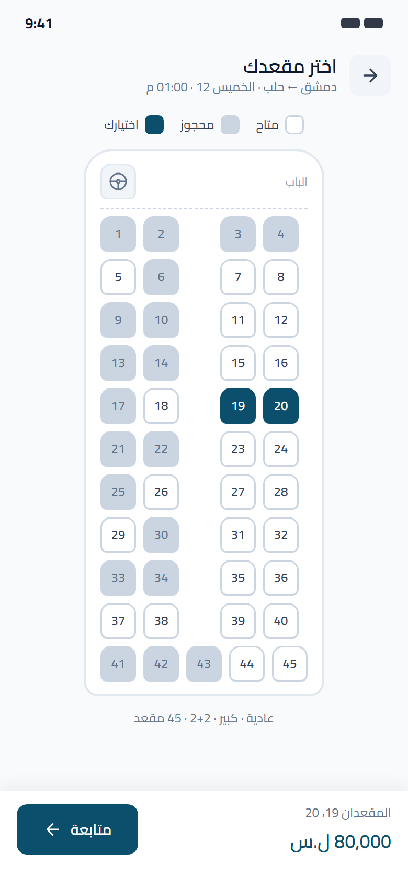
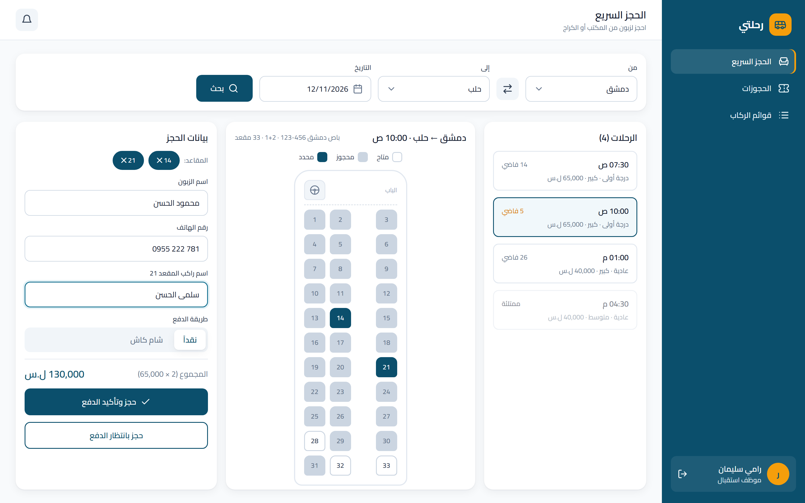

# Bus Booking System

Full-stack booking system for an intercity bus company in Syria: trips and recurring schedules, seat-map booking, cash and Sham Cash payments, and three roles.

> **Status: work in progress.** The analysis and the UI design are done; the code (backend, web, mobile) is being built.

| Customer app | Reception: quick booking |
| :---: | :---: |
|  |  |

---

## The Problem

The company runs buses between Syrian cities, but customers can't easily see which trips exist, their prices, or which seats are free. Booking happens only at the office.

This system gives:

- **Admin:** a dashboard to manage buses, create trips, and set recurring schedules (daily, weekly, monthly).
- **Receptionist:** a fast screen to book seats for walk-in customers and confirm payments.
- **Customer:** a mobile app to browse trips, pick a seat from the bus layout, and book.

## Features

- **Seat map built from the bus type.** 3 classes × 2 sizes = 6 layouts, generated in code, not drawn by hand:

  | Class | Layout | Large (11 rows) | Medium (9 rows) |
  | :--- | :---: | :---: | :---: |
  | Regular | 2+2 (+1 back middle seat) | 45 | 37 |
  | First class | 2+1 | 33 | 27 |
  | Business | 1+1 | 22 | 18 |

- **No double booking.** Booked seats live on the trip document and are reserved with one atomic MongoDB update that only succeeds if every requested seat is still free; otherwise the API returns `409`.
- **Recurring schedules.** A daily job keeps trips generated 30 days ahead, without creating duplicates.
- **Payments.** Cash at the office, or Sham Cash: the customer enters the transfer number and a receptionist verifies it.
- **Fixed data.** The 14 Syrian governorates and the 6 bus types are constants, not editable tables.
- **Arabic first.** Right-to-left UI.

## Roles

| Action | Admin | Receptionist | Customer |
| :--- | :---: | :---: | :---: |
| Manage buses, trips, schedules, receptionists | ✅ | ❌ | ❌ |
| View trips and seat maps | ✅ | ✅ | ✅ |
| Book for a walk-in customer | ✅ | ✅ | ❌ |
| Book for themselves (app) | ❌ | ❌ | ✅ |
| Confirm payment | ✅ | ✅ | ❌ |
| Cancel a booking | ✅ any | ✅ any | ✅ own |
| Trip manifest | ✅ | ✅ | ❌ |
| Reports | ✅ | ❌ | ❌ |

## Tech Stack

| Part | Technology |
| :--- | :--- |
| Backend | Node.js, Express, MongoDB, Mongoose, JWT, bcrypt, node-cron |
| Web (Admin + Reception) | Next.js |
| Mobile (Customer) | React Native (Expo) |

## Data Model

Five collections: `users`, `buses`, `trips`, `tripschedules`, `bookings`. Passenger seats are embedded in each booking.

## Repository Structure

```
bus-booking-system/
├── backend/     # Express + MongoDB API (planned)
├── web/         # Next.js: Admin + Receptionist (planned)
├── mobile/      # React Native (Expo): Customer (planned)
├── design/      # UI screens: HTML source, PNG exports, PDF
└── docs/        # Analysis (Arabic)
```

## Design

All 21 screens (11 mobile, 10 web) are in [`design/`](design):

- [`design/screens/`](design/screens): one PNG per screen.
- [`design/bus-booking-screens.pdf`](design/bus-booking-screens.pdf): every screen in one file.
- `design/mobile.html` and `design/web.html`: the editable source. After editing, run `node build-share.mjs` inside `design/` to rebuild the single-file copies in `design/share/`.

## Documentation

- [Analysis](docs/analysis.pdf) (Arabic): requirements, roles, design decisions, data model, API draft, screens.

## Roadmap

- [x] Analysis
- [x] UI design
- [ ] Backend: auth and roles, buses, trips, schedules, bookings
- [ ] Web dashboard (Admin + Receptionist)
- [ ] Mobile app (Customer)
- [ ] Live demo

## License

[MIT](LICENSE)
